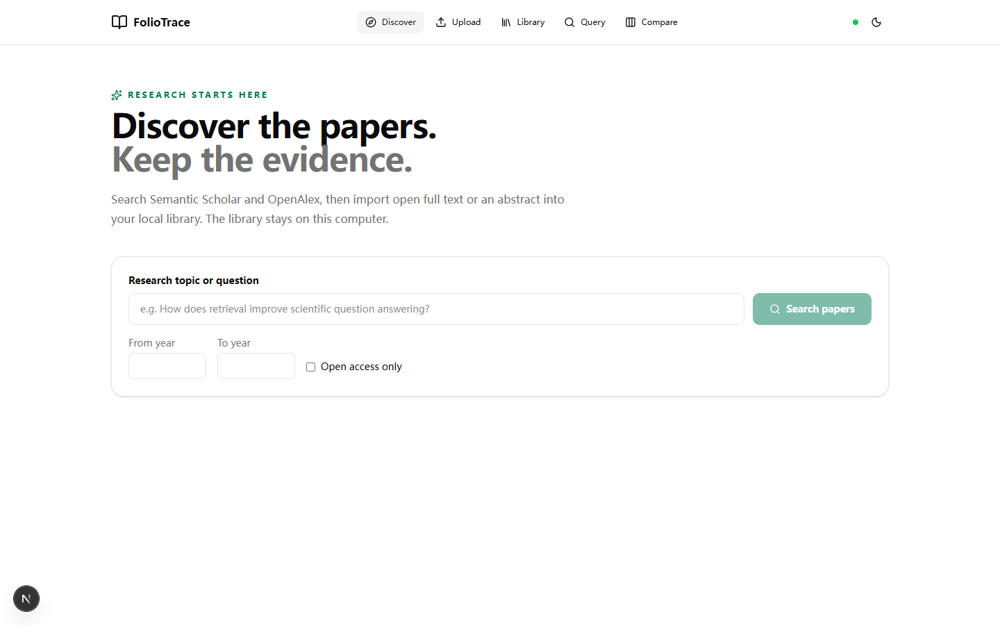

# FolioTrace

A local research assistant for discovering papers and tracing answers to source excerpts. FolioTrace includes a FastAPI backend, a Next.js frontend, SQLite with FTS5, and Qdrant.



## Current features

- Discover papers through four possible sources, selected automatically by English topic terms: general research uses OpenAlex and Semantic Scholar; AI/CS uses Semantic Scholar and arXiv; medical and biological research uses PubMed and OpenAlex. Mixed topics combine the relevant pairs. Search shows up to 20 papers per request, and **Load more papers** continues each selected source without a fixed library limit. Topic chips filter papers already loaded. Results include source abstracts, topic-match reasons, and citation counts where available. DOI duplicates are merged; papers in each loaded batch are reranked by title, abstract, and topic matches, then provider order, citations, and recency. Recent and highly cited labels describe source signals, not research quality. A failed provider leaves other results visible.
- Open **Explore DOI metadata** on a paper with a DOI to fetch venue, publisher, date, type, and deposited reference count from Crossref. This makes one optional Crossref request and does not request a separate citation graph.
- When adding a paper to the library, the importer tries its public PDF first, then checks Unpaywall for an open PDF when `UNPAYWALL_EMAIL` is configured. If no usable PDF is found, it keeps the abstract or metadata and shows the actual content scope. The **Abstract preview** label in search describes the result card; it does not predict the import outcome.
- Click **Add to library** on one result or select several for a batch import. Open PDFs are parsed by page; unavailable PDFs fall back to abstracts or metadata. DOI, arXiv and provider IDs prevent duplicate imports. The library has no fixed paper count limit.
- Upload PDFs or paste text, and review generated claims where API keys are available.
- Ask questions against local source excerpts, filter by paper, year or provider, and compare 2–5 papers in an evidence matrix. Generated claims must cite an existing excerpt and quote text from it; a second Anthropic call checks whether each claim is supported by those quotes before it is shown. This adds latency and API usage, and model-based checks cannot guarantee factual correctness. If the support check is unavailable, no unchecked generated claim is shown. Previously approved patterns that are rejected are excluded from legacy search.
- Use SQLite FTS5 keyword search, Qdrant dense search, or experimental RRF hybrid search. Dense retrieval falls back to keyword search when vectors are unavailable. Each answer cites only SQLite excerpts; abstract excerpts have no invented page number.
- The query page automatically turns questions into standalone retrieval queries and adds up to three related search terms when an Anthropic API key is configured. The answer still addresses the original question, and the effective search query is shown with the result. If rewriting is unavailable, search uses the current question with the previous question for context. The extra model call adds latency and API usage; keyword expansion can occasionally broaden results beyond the intended topic.

## Run locally

### Native app with Qdrant in Docker

Install Python 3.12+, [uv](https://docs.astral.sh/uv/), Node.js 20+, and Docker Desktop. From the repository root, run these PowerShell commands:

```powershell
docker compose up -d qdrant
if (!(Test-Path backend/.env)) { Copy-Item backend/.env.example backend/.env }
New-Item -ItemType Directory -Force backend/data | Out-Null
```

Add keys to `backend/.env` when needed. `ANTHROPIC_API_KEY` enables generated answers and claim extraction; `OPENAI_API_KEY` enables dense indexing and search. Paper discovery and SQLite keyword search work without either key. `SEMANTIC_SCHOLAR_API_KEY` and `NCBI_API_KEY` are optional; `NCBI_EMAIL` can identify your NCBI requests. Set `UNPAYWALL_EMAIL` to an email address to enable Unpaywall DOI lookups. Environment files are ignored by Git. Full text is never guaranteed; provider limits, access rights, missing identifiers, or extraction failures can leave a paper at abstract or metadata scope. [NCBI E-utilities guidance](https://www.ncbi.nlm.nih.gov/books/NBK25497/) describes its request limits and [NCBI's disclaimer](https://www.ncbi.nlm.nih.gov/About/disclaimer.html) applies to PubMed data.

Start the API in one terminal:

```powershell
cd backend
uv sync
uv run alembic upgrade head
uv run uvicorn app.main:app --reload --host 127.0.0.1 --port 8000
```

Start the frontend in another terminal, from the repository root:

```powershell
cd frontend
npm ci
npm run dev
```

Open [http://localhost:3000/discover](http://localhost:3000/discover). The header should show a green backend connection indicator. [http://localhost:8000/health](http://localhost:8000/health) reports the SQLite and Qdrant status. Use `localhost` for the frontend: the API currently allows that origin on port 3000.

### All services in Docker

To let Compose build and run the frontend, API, and Qdrant together instead, run this from the repository root:

```powershell
if (!(Test-Path .env)) { Copy-Item .env.example .env }
docker compose up --build
```

Open [http://localhost:3000/discover](http://localhost:3000/discover). Compose runs SQLite migrations at startup and stores its database and Qdrant data in Docker volumes. This SQLite database is separate from `backend/data/research.db` used by the native API, so papers imported through one setup do not automatically appear in the other.

After adding an OpenAI key to a library created without one, run `uv run python -m evaluation.reindex` from `backend/` to rebuild source vectors. Keywords remain searchable while indexing is unavailable.

Retrieval quality is not yet certified: the spec requires 40 independently labelled queries before hybrid search becomes the default. Run `uv run python -m evaluation.evaluate labels.jsonl --output report.json` from `backend/` after creating that dataset. Each JSONL row needs a `query` and `relevant_chunk_ids`; an empty relevant list marks an unanswerable case. Add `--judge` and install DeepEval to include Faithfulness scoring. The script reports Recall@10, nDCG@10, Hit@10, MRR@10, and latency for each retrieval mode. Relevance metric means use only answerable cases; `no_answer_count` reports excluded cases, while latency includes every query. It rejects an uncited answer when relevant evidence is labelled, rejects unknown citation IDs, and accepts an uncited unanswerable case only when the answer explicitly abstains.

## Discovery evaluation

The discovery API returns `searched_sources`, `failed_sources`, and `search_latency_ms` with each search. Save search responses for a fixed set of queries, label the relevant DOIs independently, and place them in a JSON file shaped like `{"cases": [{"query": "...", "relevant_dois": ["10.1000/example"], "result": { ...search response... }}]}`. From `backend/`, run `uv run python -m evaluation.discovery_metrics judgments.json` to report unique relevant papers@50, Recall@50, search latency, and provider failure rate. To measure **actual** full-text availability, first import the papers and add each resulting `content_scope` (`full_text`, `abstract`, or `metadata`) to its saved candidate; otherwise that metric is reported as unavailable. These metrics need human judgments and saved runs before they can support a before/after quality claim. The query router uses English topic cues and may miss unfamiliar or non-English terminology; the displayed reranking applies to fetched results, not the entire scholarly corpus.

## License

This code is distributed under the MIT License. See [LICENSE](LICENSE) for the original copyright notice and license terms.
