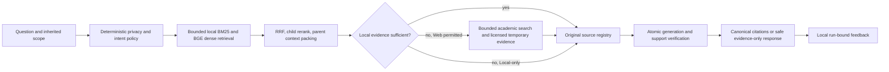

# Local RAG architecture decisions

SQLite stores authoritative paper identities, immutable source transcripts,
raw spans, historical citations, source generations and local feedback. FTS5
is a derived lexical index whose actual postings can be reconciled. Qdrant
stores derived, model-specific dense vectors with dataset/paper/generation
payloads. A ready certificate requires physical readback; absence, corruption
or unavailability cannot grant evidence authority.

This project retains SQLite+FTS5/Qdrant because the existing single-user
workflow already has persistence, filtering, recoverable source publication
and tested scope checks around them. A FAISS or sqlite-vec alternative would
require a new adapter and equivalent publication/recovery/privacy evidence.
Neither alternative was benchmarked here; no superiority claim is made.
[SQLite FTS5](https://www.sqlite.org/fts5.html) documents lexical indexing;
[Qdrant's local setup](https://qdrant.tech/documentation/quickstart/) documents
the server and Windows named-volume option used by this installation.

The local embedding default is BAAI/bge-small-en-v1.5,384 dimensions. Weights
are cached persistently; model identity/dimensions and normalized input hashes
key validated embedding reuse. A model change uses another collection and
requires reindex/publication. Do not reuse old vectors under a new model name.
SQLite original history survives repair and migration. Back up SQLite first;
`evaluation.check_index` is dry by default, and `--repair` is serial/scoped.

Native generation uses child/parent segmentation and retained raw anchors.
Reranking uses the original question. Parent background can aid interpretation
but cannot automatically become a child citation. Reports separate citable
evidence coverage from visible parent-context coverage. Partial context and
unknown scientific comparability must remain visible.

The core is deterministic Local-first Hybrid + Parent-Child with a
CRAG-inspired, bounded evidence fallback. It has no autonomous tool loop:
document content cannot grant network/write privileges. Local-only and
uploaded-only policy override freshness requests. An explicit publication
status refresh is separate from query routing. Unknown retraction is not
evidence that a paper is unretracted.

Agent loops, GraphRAG, Self-RAG training, default HyDE and multi-agent runtime
orchestration are deferred. They add implementation/evaluation work and model
calls without measured benefit on this project's current task set. Revisit
only after a fixed-pipeline failure set demonstrates a concrete multi-hop or
coverage limitation and a frozen comparison shows a useful quality/cost/latency
tradeoff. This delivery does not create a new agent-development workstream.

The runtime is a local single-user product. M7's30 simple synthetic requests
and M8's actual retrieval/stress traces describe this machine and these
workloads. Random-vector replay measures storage/search resources, not answer
quality, concurrent-user capacity or100k-user scalability. API reservations
are not invoices, and local zero provider billing does not mean zero CPU/GPU,
memory or energy cost. Stage timings, resource observations and limitations
are linked from the final evaluation report.
